 

### 任務 · Missions

<table align="center">
<tr><th></th><th align="left">Mission</th><th align="left">What it is</th><th align="left">Jutsu</th></tr>
<tr><td align="center"><b>開</b></td><td><a href="https://github.com/shoshiiiin/iphone-tracker-check"><b>iphone-tracker-check</b></a></td><td>Read-only check of your own iPhone for stalkerware: apps, MDM profiles, network traffic.</td><td><code>Python</code></td></tr>
<tr><td align="center"><b>封</b></td><td><b>Sealed scrolls</b></td><td>The private repositories. Their names stay in the dark; their commits light the eye above.</td><td><code>…</code></td></tr>
</table>

 

Every image here is generated from code: <code>npm run build</code>. No JavaScript runs on GitHub, so all motion is CSS inside SVG, and it stands still for anyone who prefers reduced motion.

